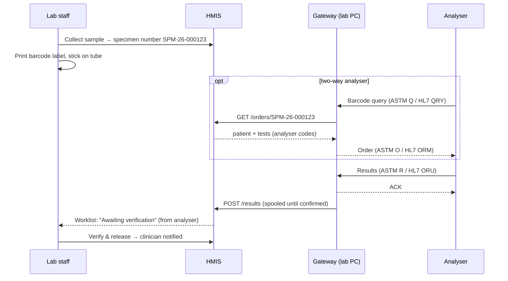

# Laboratory analyser integration

HMIS receives results directly from laboratory analysers, and can send them the worklist. A small **device gateway** ([`gateway/`](../gateway/README.md)) runs on the hospital network, speaks the analysers' protocols, and relays to HMIS over HTTPS.



## Safety rules

- **Machines never sign off results.** Instrument results arrive as *resulted*. A qualified person must **verify** before release, as for manual results. Because no person entered an instrument result, any authorised verifier may verify it, and the verifier is recorded.
- **Verified results are locked.** Once verified or released, an analyser re-run cannot change them: the message is logged as *rejected*.
- **Re-runs before verification** replace the earlier instrument result.
- **Manual override:** if a technician types a result over an instrument result, it becomes that person's result. They must then not verify it themselves (independent verification).
- **Nothing is lost.** Unknown samples and unmapped codes are logged as *unmatched* or *partial* under **Lab analysers → Recent messages**, with the raw message. The gateway spools results while HMIS is unreachable.
- **Hospitals are isolated.** A gateway's token belongs to one hospital, and every API query is scoped to it.

## Set-up in HMIS (Diagnostics → Lab analysers)

1. **Gateway:** create one per lab PC. The token (`hgw_…`) is shown **once**; only its SHA-256 hash is stored. **Rotate** it if it leaks; disable the gateway to cut it off.
2. **Analysers:** name, manufacturer/model, a **code** (must match the gateway config), protocol (ASTM or HL7), gateway, and whether it is **bidirectional** (receives orders).
3. **Code mapping:** analyser code → HMIS test, plus a **component** for panels.
   - A **panel** test such as *Full blood count* collects several codes (WBC, HGB, PLT…) as components. They show as a table in the worklist, the clinician's view and the printed report. The overall flag is the worst one (critical > high/low > normal).
   - A **single** test (e.g. *Random blood sugar*) takes one code with no component.
   - One analyser code may map to several tests (e.g. `GLU` → *RBS* and *FBS*). The test ordered for that sample decides which applies.
   - **Presets** add the usual codes for 3-part and 5-part haematology and for chemistry analysers. Always check them against the analyser's host-interface manual.
4. **Labels:** after **Collect specimen**, use **Label** in the worklist to print a 50 × 25 mm label with a **Code 128** barcode of the specimen number. That number is the sample ID the analyser reads and reports.

## LIS API (gateway → HMIS)

Base URL `https://<host>/api/lis/v1`, header `Authorization: Bearer hgw_…`, JSON. Rate limit: 600 requests per minute per gateway.

| Method | Path | Purpose |
|---|---|---|
| POST | `/heartbeat` | Presence and version; returns the gateway's analysers and their code mappings |
| GET | `/orders?instrument=CODE` | Worklist for a **bidirectional** analyser: collected samples (last 7 days) whose tests this analyser runs |
| GET | `/orders/{sample}?instrument=CODE` | Host query for one barcode |
| POST | `/results` | Results for one sample |

`POST /results` body (all values as **strings**):

```json
{
  "instrument": "BC30-LAB1",
  "sample_id": "SPM-26-000123",
  "results": [
    {"code": "HGB", "value": "13.4", "unit": "g/dL", "reference_range": "11.0-16.0", "flag": "N"},
    {"code": "PLT", "value": "512", "unit": "10*9/L", "reference_range": "100-300", "flag": "H"}
  ],
  "raw": "MSH|^~\\&|BC-30s|…"
}
```

Responses:

| HTTP | `status` | Meaning | Gateway action |
|---|---|---|---|
| 200 | `accepted` | Saved; awaiting verification | Done |
| 200 | `partial` | Saved; some codes unmapped (listed in `unmapped`) | Done |
| 202 | `unmatched` | Unknown sample, or no mapped codes for its test | Done (logged in HMIS for the lab to review) |
| 202 | `rejected` | Test already verified, released or cancelled | Done |
| 401 / 404 | — | Bad token / unknown analyser | Keep in spool and retry; fix the configuration |
| 422 | — | Malformed request | Move to dead letters |
| 5xx / network | — | HMIS unavailable | Keep in spool; retry with back-off (30 s → 30 min) |

Flags are normalised: `H/HI` → high, `L/LO` → low, `HH/LL/AA/C/>/<` → critical, `N` → normal. With no flag, HMIS computes one from the reference range sent (`low-high` or `low to high`), or from the test's own range.

## Protocol notes (gateway)

- **ASTM E1381:** ENQ/ACK handshake, frames `STX FN text ETX|ETB C1C2 CR LF` with a mod-256 checksum (NAK on mismatch), 240-character frames, frame numbers 0–7, EOT at the end. On contention, the analyser has priority.
- **ASTM E1394 records:** delimiters are read from the `H` record. The sample ID is `O.3` (fallback `O.4`), the test code is `R.3` component 4 (`^^^GLU`), the value is `R.4`, then units, range and flag. `R.9` = `X` (cannot be done) is skipped. Queries are `Q.3`. Order replies use `P` + `O` records with priority S/A/R and report type `O`. "No information" is `L|1|I`.
- **HL7 v2:** MLLP framing. ORU^R01: the sample ID is OBR-3 (fallback OBR-2), and results are OBX with the code from OBX-3 (`auto` mode takes the second component when the coding system is LOINC, e.g. `6690-2^WBC^LN` → `WBC`). Histograms (ED), references (RP) and coded settings (IS) are skipped. Every message gets an `ACK` (MSA|AA). Bidirectional analysers receive ORM^O01.

## Go-live checklist per analyser

- [ ] The vendor engineer has enabled the LIS/host interface and noted the protocol, port and serial settings
- [ ] The analyser and gateway are added in HMIS; codes mapped and checked against the vendor manual
- [ ] `--check` shows the analyser `OK`
- [ ] **Parallel run:** for one day, compare at least 20 analyser results in HMIS with the analyser's own printout (values, units, flags)
- [ ] Labels print and scan on the analyser's barcode reader
- [ ] Staff trained: instrument results still need **verification** (training module *Laboratory and radiology*)
