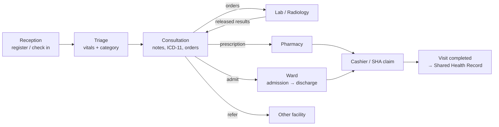
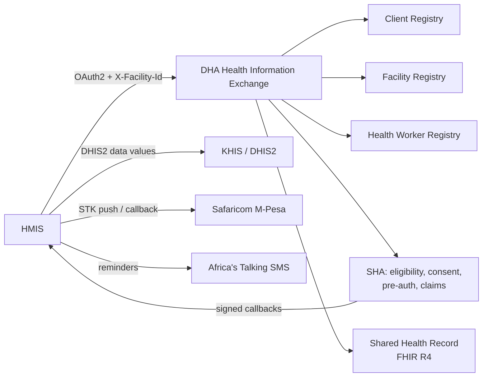

# How HMIS works

HMIS is a web-based, multi-tenant **Hospital Management Information System** built for Kenyan health facilities from **KEPH level 1** (community) to **level 6** (national referral). One installation serves many hospitals. Each hospital's data is kept separate, and each hospital sees only the modules that fit its level.

## Modules

| Area | Modules |
|---|---|
| Front office | Patients (registry, Client Registry lookup, merge), Reception and check-in, Appointments with SMS reminders, Referrals across KEPH levels |
| Clinical | Triage (five-level categories), Doctor worklist and consultation (signed notes, ICD-11, orders, prescriptions, certificates), Emergency |
| Diagnostics | Laboratory (collect → result → independent verification → release), Radiology (schedule → perform → report → verify), catalogs with SHA codes |
| Pharmacy & stores | Dispensing, medicines and batches with expiry, stores, suppliers, purchase orders, goods received, issues |
| Maternity & child | ANC/PNC clinic, Labour ward with partograph, delivery and newborns, Child welfare clinic (KEPI immunisation, growth), HEI follow-up |
| Inpatient | Admissions, Ward board, admission record (observations, medication chart, transfers, discharge), Theatre (safety checklist), Critical care |
| Specialist services | Blood bank, Mortuary, Renal/dialysis, specialist clinics (oncology, physiotherapy, dental, eye, ENT, psychiatry) |
| Finance | Cashier (cash, card, bank, **M-Pesa STK push**), discounts, voids, refunds with vouchers, Insurance and **SHA claims**, pre-authorisations, remittance matching |
| Management | Reports, **MOH 705A/705B/717/405/333/406** with CSV and **DHIS2** export, Audit log, Training records |
| Administration | Institution profile and branding, Facilities and levels, Departments, Staff with email invitations, Roles & permissions, Integrations, Security policy |
| Platform | Hospitals (tenants), ICD-11 classification, SEO & sitemap, time-limited support access |

## The patient journey

Each outpatient visit (an **encounter**) has a **stage**: *Waiting triage → Waiting for doctor → In consultation → Awaiting results / Waiting pharmacy / Waiting billing → Completed* (or *Admitted*). Each department's worklist shows the patients at its stage. Lists update **live**: a change made by one user appears on colleagues' screens within seconds. Charges are added to the bill **automatically** when services are ordered, dispensed or given.

## National integrations

- **Standards:** ICD-11 (MMS) for diagnoses, HL7 **FHIR R4** for the Shared Health Record, SHA intervention codes for services, and DHIS2 data value sets for KHIS.
- **Resilience:** claim submission is never retried automatically, to avoid duplicates. Shared Health Record pushes run in the background and retry. SHA status updates arrive by **HMAC-signed** callbacks.
- **Simulator:** until a hospital enters its credentials, every integration runs against a built-in simulator, for training and testing.

## Security and privacy

| Control | How |
|---|---|
| Tenant isolation | Every record is scoped to its hospital; foreign IDs return "not found" |
| Access control | Roles and permissions per hospital (least privilege); modules gated by facility level |
| Authentication | Email + password, optional two-factor authentication and passkeys, email invitations with single-use 72-hour links |
| Session policy | Per-hospital idle timeout and optional IP allow-list |
| Encryption | HTTPS everywhere; national ID, CR and SHA numbers encrypted at rest with a blind index for search; integration credentials encrypted |
| Audit | Sign-ins, views and changes logged with user, time and IP; signed clinical notes are versioned |
| Support access | Break-glass is time-boxed, read-only, needs a reason, is audited and notifies hospital admins |
| Privacy online | Every signed-in page is `noindex`; robots.txt blocks everything but the public login page |

## Technology

Laravel (PHP 8.3+), Livewire and Flux UI, MySQL, a queue worker for background jobs, and the task scheduler (daily SMS reminders, nightly sitemap). It runs behind nginx with Let's Encrypt TLS. Deployments use `deploy.sh`: pull, install, migrate (additive only), build, cache and restart workers. An automated test suite covers the workflows, integrations, security and training.
